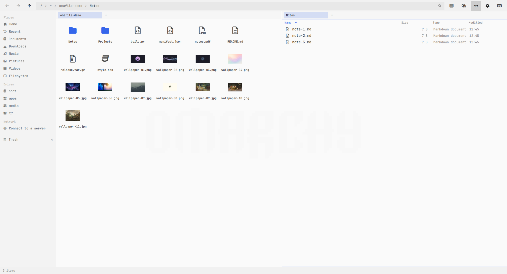

A lightweight, fast file manager plugin for Omarchy running in the shell.



## Features

* Real resizable window with tabs for multiple locations
* Dual pane layout with one-key copy and move between panes
* List, compact, grid and gallery views, with zoom from Ctrl+Scroll or the View menu
* Sort from the View menu in any view: A to Z, Z to A, last modified, size or type
* Quick preview with Space: images up to 1024 px, text files such as `.yml` as plain text, and audio files play with a seek bar, cover art and volume
* Mouse back and forward buttons move through folder history
* Can stand in for the GTK file chooser, so browser uploads and downloads open Omafile
* Live directory watching: external changes appear immediately
* Background copy and move with persistent progress tracking
* Freedesktop trash integration, compatible with GNOME Files, with Empty trash and Restore in the trash view
* Recursive file search across directories
* Find duplicate files and compare two copies side by side before trashing one
* A simple built in text editor for config files, notes and scripts
* Thumbnails in list, compact, grid and gallery view for images, videos, PDFs, office files and anything else your system has a thumbnailer for
* Recent files, and bookmarks for the folders you use most
* Connect to SMB, SFTP, WebDAV and other servers
* Settings inside the window, no config file editing
* Bar widget with places, drives, transfers, and trash overview
* Optional standalone trash can in the bar, placeable anywhere, with a live count
* Full keyboard control, following GNOME Files conventions
* Undo and redo for trash, rename, move, copy and new items

## Requirements

* Omarchy 4 (Quattro)
* Python 3 (included with Omarchy)
* util-linux `lsblk` and `findmnt` (included with Arch)
* Optional: `udisksctl` for mounting, unlocking and ejecting drives
* Optional: `gvfs` and `gvfs-smb` for connecting to network servers
* Optional: PyGObject for Show in folder from other applications
* Optional: `qt6-multimedia` and `ffmpeg` for playing audio in the preview (Omarchy installs both)

## Install

```bash
omarchy plugin add https://github.com/chr0nzz/omarchy-omafile.git --enable --yes
```

Plugins run unsandboxed inside the shell process and have full access to your home directory.

## Keybinding and Window Rule

Add to `~/.config/hypr/bindings.lua`:

```lua
o.bind("SUPER + E", "Omafile", "omarchy-shell shell toggle xyzlab.omafile '{}'")
```

Add to `~/.config/hypr/windows.lua`:

```lua
o.window({ class = "^org.quickshell$", title = "^Omafile( [0-9]+)?$" }, { float = true, size = { 1100, 720 }, center = true })
```

Omarchy makes every window slightly transparent, so your wallpaper shows faintly through Omafile the same way it does through every other app. If you would rather Omafile were solid, opt it out of that rule:

```lua
o.window({ class = "^org.quickshell$", title = "^Omafile( [0-9]+)?$" }, { tag = "-default-opacity", opacity = "1 1" })
```

## Usage

Super+E toggles the window. If it is already open it comes to the front. Ctrl+Q closes it, and Escape closes the popup.

To open another window each time instead, bind `omarchy-shell omafile newwindow`. Extra windows are titled `Omafile 2`, `Omafile 3` and so on, and each opens a little down and to the right of the first. Escape closes only the window you are in.

```lua
hl.unbind("SUPER + E")
o.bind("SUPER + E", "Omafile (new window)", "omarchy-shell omafile newwindow")
```

Moving around is covered in [Keyboard](#keyboard); F1 shows the same list inside the window.

### Finding things

Click any part of the address bar to type a path, or press Ctrl+L. Click a breadcrumb to jump to that folder.

The magnifier at the end of the address bar filters the folder you are in. Ctrl+F searches that folder and everything inside it instead. Escape clears the text, then leaves the results.

### Sorting

The Sort by section of the View menu sorts by A to Z, Z to A, last modified, first modified, largest, smallest or type, in every view. In list view you can also click Name, Size, Type or Modified. Click the same column again to reverse its order.

### Views

The View button in the toolbar opens one menu for the layout, zoom, sorting and hidden files. It switches between list, compact, grid and gallery. Compact packs names into columns. Gallery shows large image previews. Ctrl+1 to Ctrl+4 pick them from the keyboard.

Each folder remembers the view you last picked in it, and folders you have not set open in the default view. Turn off **Remember the view for each folder** in Settings, under Browsing, to keep one view per tab instead. Omafile keeps the last 500 folders.

Grid view can show captions under each name, like GNOME Files: pick up to three from Size (item count for folders), Type, Modified and Permissions under Settings, View, or with Grid captions in the View menu. The first shows at any size, the second from 90 percent zoom and the third from 130 percent.

Zoom scales rows, icons and grid cells from 50 to 300 percent. Use the minus and plus buttons in the View menu, Ctrl with the scroll wheel over a pane, or Ctrl+Plus, Ctrl+Minus and Ctrl+0. Click the percentage to go back to 100 percent.

### Preview

Press Space on a file to preview it without opening another app. Images are shown at up to 1024 px, made by your system's thumbnailer rather than decoded inside the shell, so a crafted image cannot weigh the desktop down; image previews follow the Previews and thumbnails setting. Text files such as `.yml`, `.json`, `.md` or scripts are shown as text, up to the first 256 KB. Arrow keys move to the next file while the preview stays open. Enter opens the file, and Space or Escape closes the preview. Preview is also in the right click menu.

Scroll over a picture to zoom in at the pointer, up to 8 times, and drag to move around. Double click, or press 0, to fit it again, and + and - zoom from the keyboard. The zoom stays as you arrow to the next picture, which starts centred. **Image preview size** in Settings, under Browsing, sets how sharp the preview is. **Automatic**, the default, matches the preview to your screen's real pixels: 1024 px on a 1080p screen, 2048 or 4096 px on a 4K one. Pick 4096 px or 7680 px to see more detail when you zoom in, up to native resolution for 8K pictures. A picture is never made bigger than it is. Previews above 1024 px take a few seconds the first time, about 4 seconds for an 8K picture, and are kept in Omafile's own cache so the next look is instant. While one is made the standard preview shows, so arrowing through a folder stays quick. They are made by your system's thumbnailer like every other preview; the original file is still never decoded inside the shell.

Audio files (`.mp3`, `.flac`, `.ogg`, `.opus`, `.m4a`, `.aac`, `.wav`, `.wma`) start playing as soon as the preview opens, with the title, artist, album and cover art when the file has them. Arrow to the next file to hear it instead, which makes it quick to go through a folder of tracks or samples. K or P plays and pauses, Shift+Left and Shift+Right skip 5 seconds, and M mutes. Playback stops when the preview closes. The volume is kept while the window stays open. Playing audio needs Qt Multimedia, which Omarchy already installs alongside Kdenlive. Without it the preview says to install `qt6-multimedia`. The shell plays a copy of the song's audio that Omafile makes with `ffmpeg`, without cover art or tags, so a crafted song cannot reach the shell's media player; the cover comes from the thumbnailer instead.

Open, Open with and Open in editor in the right click menu act on every selected item when you right click one of them. Opening several files starts each app once with all of its files, the way GNOME Files does, instead of a window per file. Apps that take one file at a time get one launch per file.

Open with in the right click menu lists your apps with their icons. Click an app to select it, then double click it or press Open. Turn on **Always open ... with this app** to make it the default for that file type, the same default double click and Opens with in Properties use. It is not offered for folders.

Right click an archive and choose **Extract here** to extract it next to itself. It works on several selected archives at once. Zip, tar, 7z and rar files are supported. An archive with one item at the top, such as a single folder, extracts as that item. Anything else goes into a new folder named after the archive. Existing files are never overwritten: a clashing name gets a number. Extractions show in the Transfers panel with how much of the archive has been read, the number of files so far and a button to cancel. A cancelled or failed extraction leaves nothing behind. The extracted item is selected when it is done. Double click and Enter open an archive in your default app, unless you turn on **Extract archives when opened** in Settings, under Browsing, which makes them extract it instead, as GNOME Files does.

To make an archive, select files or folders, right click and choose **Compress…**. Name it and pick a format: `.zip` opens anywhere, `.tar.xz` and `.tar.gz` suit Linux and macOS, and `.7z` is the smallest but needs 7-Zip on Windows. The archive is made next to the items, shows in the Transfers panel with a cancel button, and is selected when it is done. An existing file with the same name is never replaced: the new archive gets a number.

Right click a picture or video, or several, and choose **Transcode…** to make a copy for sharing, with the same presets as Omarchy's `omarchy transcode`. Pictures become JPG, PNG, WebP, AVIF or JPEG XL at high (3160 px wide), medium (2160 px), low (1080 px) or their original size, turned the right way up and without their metadata, such as where a photo was taken. Videos become MP4 or GIF at 4K, 1080p, 720p or their original size, also without metadata. Original size keeps every pixel, except that a video's width and height are rounded down to even numbers, which MP4 needs. The copy is made next to each file as `name-size.format`, shows in the Transfers panel with a cancel button, and is selected when it is done. An existing file is never replaced: the copy gets a number. Unlike `omarchy transcode`, it does not replace your clipboard. WebP and AVIF are much smaller than JPG at the same quality and keep transparency, which JPG cannot; AVIF is the smallest but slower to make. JPEG XL is as small, is the best choice for keeping your own pictures, and is still not opened by every app or browser, so WebP is safer for sending. For a JPG, JPEG XL also offers **Lossless repack**: the picture is packed about 20 percent smaller with every pixel and its metadata kept, and `djxl` turns it back into a byte for byte copy of the original JPG. Lossless repack needs `cjxl` from libjxl, which Omarchy installs. Transcoding needs ImageMagick for pictures and `ffmpeg` for videos, which Omarchy installs.

### Editing text

Right click a text file and choose **Edit**, or press Ctrl+E, to edit it inside Omafile without opening another app. It is meant for quick changes to config files, notes and scripts up to 1 MB.

* Ctrl+S saves. A dot before the name means there are unsaved changes, and closing asks whether to save them.
* Ctrl+Z and Ctrl+Shift+Z undo and redo, a word at a time. Ctrl+X, Ctrl+C and Ctrl+V cut, copy and paste.
* Enter keeps the indentation of the line. Tab indents with the file's own style, tabs or spaces, and Tab or Shift+Tab on a selection indents or outdents every selected line.
* Ctrl+F finds text. Enter or F3 goes to the next match and Shift+Enter or Shift+F3 to the previous one. A search in lower case ignores case.
* Alt+Z, or the Wrap button, turns line wrapping on and off. PageUp and PageDown move a screen at a time.
* Escape, Ctrl+W or the close button closes the editor.
* **Auto save**, in the editor's header or under Settings, Browsing, saves a second after you stop typing and when the editor or its window closes. It is off by default, because apps that reload their config when it is saved, such as Hyprland, would apply each half typed change. If the file changed on disk, or a save fails, auto save pauses until you save by hand, so it never overwrites another app's changes.

The file is saved exactly as you typed it, as UTF-8, keeping its Windows or Unix line endings and its byte order mark. Saving writes a new copy and swaps it in, so a crash halfway never leaves half a file, and the file keeps its permissions. A file with other hard links is written in place instead, so every name sees the change. If the file changed on disk since you opened it, saving asks whether to overwrite it or load the new version. Opening a link edits the file it points to. Files that are not UTF-8 text, that are bigger than 1 MB, that have a line over 20,000 characters, such as minified code, or that have stray carriage returns are not opened, because editing them inside the shell would be slow or would change them. Files you cannot write open read only. Omafile asks before it closes the editor with unsaved changes. Closing the window from Hyprland, or toggling the popup away with its key, closes it without asking: with auto save on, your changes are saved first, and with it off they are lost.

### Finding duplicates

Right click a file and choose **Find duplicates…** to find other copies of it with exactly the same contents. Omafile looks through your home folder, or the file's own folder when it is outside your home; the menu at the top switches between the file's folder and your home folder. Right click a folder and choose **Find duplicates in this folder**, or right click empty space and choose **Find duplicates here**, to find every file in it that has a copy.

Two copies show side by side with a preview, where each one is, its size and when it was changed, and the newest and oldest are marked. The file you picked, or the oldest copy, is on the left. Left and Right arrows, or the list below, choose which other copy is on the right. A folder search lists every file that has copies on the left, largest first; Up and Down move through them.

* **Move to trash** trashes that copy. Delete trashes the copy on the right.
* **Keep only this** keeps that copy and trashes every other one, after asking.
* **Open** opens a copy, and **Show in folder** closes the finder and selects the copy in its folder.

Everything goes to the trash, so Restore in the trash puts a copy back, and Ctrl+Z after closing the finder undoes the last trashing. Files count as duplicates only when every byte matches, not just the name or size. Empty files are not counted, hard links to the same file are counted once, hidden files and folders are skipped unless **Hidden files** is on, the trash is never searched, and the search stays on one drive. Escape or Stop ends a search early.

### Transfers

Copies and moves run in the background. Quick ones finish silently. Anything still running after about a second opens a small Transfers panel in the bottom right with progress, speed and time left. Click a transfer to see where it goes, how many files are done and any errors. Minimize the panel into the status bar and it stays there, with a progress bar, until you click it again. Finished transfers stay in the list so you can check them later: clear them one by one, or all at once with Clear completed.

### Thumbnails

Videos, PDFs, office documents and other files get a thumbnail from the thumbnailers your system already has, the same ones GNOME Files uses. Omarchy ships ffmpegthumbnailer for video and Evince for PDF. Thumbnails are stored in `~/.cache/thumbnails` and shared with GNOME Files, so anything it has already thumbnailed shows up straight away. The cache only holds copies you can read yourself, but it keeps them after the original moves, so clear it if a folder is private. Only root-owned, non-writable-by-others definitions in `/usr/share/thumbnailers` and `/usr/local/share/thumbnailers` are used. User thumbnailers and definitions supplied through XDG data directories are ignored. Turn thumbnails off with the `thumbnails` setting.

### Properties

`Ctrl+I` opens a dialog with two tabs. General shows the type, the application that opens the file, location, size and size on disk, and the modified, accessed and changed times. **Opens with** changes the default application for that file type, the same one double click uses. Security shows the owner and group, and a read, write and execute grid for owner, group and others. The grid is editable when you own the file, and folders can apply a change to everything inside. The group can be set to any group you belong to. Changing the owner needs the helper to run as root, so it is read only otherwise.

### The sidebar

Places, then your bookmarks, then drives, then Network, then Trash. Drag a section heading up or down to move the whole section, or right click it for Move section up, Move section down and Reset section order. Trash always stays at the bottom.

Drag a row up or down within its section to reorder Places, Bookmarks, Drives or Network. Right click a row for Move up and Move down, or press Ctrl+Up and Ctrl+Down in the sidebar. Right click a section heading, or any row in it, and choose Reset order to go back to the default. The order is kept in Omafile's `state.json`, so the GTK bookmarks file and other apps are not affected. A drive or server that is away keeps its spot for when it comes back.

Bookmarks are shared with GNOME Files and the GTK file chooser: Omafile reads and writes `~/.config/gtk-3.0/bookmarks`, so a bookmark added in either place shows up in the other straight away. To add one, right click a folder and choose Bookmark this folder, press Ctrl+D, or drag folders onto the Bookmarks heading in the sidebar. An empty bookmark list shows a drop spot. Right click a bookmark to rename it or remove it, or use the cross beside it. Bookmarks from earlier Omafile versions are merged in once. A local backup stays in `state.json`; migration completes only after the GTK write succeeds. Read or write errors appear in the status bar, and pending edits retry after a helper restart or another bookmark change.

Right click places, bookmarks and network entries for a menu: open here or in another tab or pane, copy the path, show properties, remove a bookmark, connect or disconnect a network share, or empty Trash. Drive controls remain provided by the upstream implementation.

Recent lists the files you opened most recently, newest first, from the same history the rest of the desktop uses. Opening one goes straight to the file. There is no folder above it, so leave by picking a place or a bookmark.

Unmounted partitions are listed greyed out, and clicking one mounts it through udisks and opens it. Right click a drive to open it, mount, unmount, eject or hide it. System mounts such as `/boot` can't be unmounted from here. Hover a drive and click the eye to hide it. Hidden drives come back from Settings.

Locked LUKS encrypted partitions are listed with a lock, under their LUKS label or their size, such as 2 TB Encrypted. Click one, or right click it and choose Unlock, to type its passphrase. Omafile unlocks it through udisks, mounts it and opens it. The passphrase is never stored. An internal drive can also ask for your user password, the same as mounting one does. Unmounting or ejecting an unlocked drive locks it again.

### Network drives

Connect to a server mounts an SMB share, an SFTP host, FTP or WebDAV. Servers you have used before are listed so one click reconnects, and any server the network advertises appears alongside them. Each server shows once under Network, dimmed while it is not connected. Click a server you used before to connect straight away with the address, user name, domain and anonymous choice you used last time. Passwords are never stored: SSH keys and your keyring cover most servers, and if the server still wants a password the Connect dialog opens filled in. Right click a server for Connect, Edit to change its details, or Forget this server. Right click a connected share, or use the eject button beside it, to disconnect.

This uses GVFS and needs no root. Install `gvfs-smb` for Windows shares if it is missing.

### Terminal, editor and agent

Right click a folder, or empty space for the folder you are in, and choose Open in terminal, or press Ctrl+.. The agent item starts a coding agent in that folder and leaves a shell open when it exits. It runs the agent you picked with `omarchy default agent`, such as Open Oh My Pi here, or Claude Code when you have not picked one and it is installed. Omafile starts the agent plainly, without the auto-approve flags `omarchy agent` adds, because the folder may be one you just downloaded. Set your own agent under Settings, Commands, Agent, such as `omp` or `codex --full-auto`. The item is then named after it, Open omp here.

Open in editor, right under Open with, opens the selected files or folders in an editor. The first time, it asks which one:

| Choice | What it does |
|--------|--------------|
| Omarchy's default | Follows `omarchy default editor`, so changing it there changes it here |
| Omafile's editor | Opens a text file in Omafile's own editor, the same as **Edit**. Folders, several files at once, and files it cannot edit open in Omarchy's default editor instead |
| An editor you have | VS Code, Zed, Neovim, nano and the others Omafile finds installed. Terminal editors open in your terminal. For an editor Omarchy knows, **Also make it Omarchy's default editor** sets it for all of Omarchy too |
| A command you type | Anything on your `PATH`, such as `code --new-window` or `alacritty -e nvim` |

Omafile remembers the choice. Change it under Settings, Commands, Editor, or pick Ask the first time to be asked again. If a saved command no longer exists, Open in editor asks again instead of failing.

### Settings

Ctrl+Comma, or Settings in the menu at the right end of the toolbar. Hidden files, folders-first ordering, image previews, trash behaviour, the drive list, and the trash can in the bar.

Settings also picks whether Omafile is a normal window or a popup panel centred over the desktop that closes when you click away. The change applies immediately, even while Omafile is open.

### Opening folders from other apps

Turn on Default file manager in Settings. Folders opened from anywhere else then land in Omafile, and Show in folder opens the containing folder with the file selected. It also puts Omafile in your application launcher, using the same folder icon as the bar widget. Turning it off restores the handler you had before. If something else later takes the folder handler back, such as a system upgrade rewriting `~/.config/mimeapps.list`, Omafile claims it again the next time the shell starts.

Two separate mechanisms are involved, which is why some apps can follow it and others not:

| Mechanism | Used by |
|-----------|---------|
| `inode/directory` pointed at a desktop entry in `~/.local/share/applications/` | `xdg-open`, `gio open`, most desktop apps |
| `org.freedesktop.FileManager1` claimed through a user D-Bus service file | browsers and editors, for Show in folder |

The D-Bus half needs PyGObject, which Omarchy ships. Without it the desktop entry still works and Show in folder keeps going to your previous file manager.

The desktop entry half from a terminal:

```bash
gio mime inode/directory xyzlab.omafile.desktop
gio mime inode/directory
```

### Picking files for other apps

Turn on Pick files for other apps in Settings, under Opening. When a browser or another app asks you to choose a file, for example Upload file in Chrome or Firefox, Omafile opens instead of the GTK file chooser. The same goes for Save as and download locations. The chooser opens in its own floating window over the app and closes once you pick, so Omafile windows you already have open are left alone. An open popup panel closes so it does not cover the chooser. A bar along the bottom of the window shows what the app asked for, with a name box when saving and the app's file type filters. Pick a file and press Enter or the Select button, or press `Escape` to cancel. To make a folder first, choose New folder from the menu at the top right or press Ctrl+Shift+N; the chooser opens it, ready to pick or save into.

The chooser is only for choosing. The title names the app that asked, when the portal says which one. Trash, delete, paste, drop, rename, Properties, undo, the terminal and the other actions that change files are switched off while it is open, and no thumbnails are made for the folder the app opened it in. One app at a time can use it: a second request is turned down instead of replacing the one you are answering. Links are not handed out, so pick the file a link points to instead. When an app saves several files into a folder that already has some of those names, the new files get numbered names, so nothing there is overwritten.

An app can open the chooser while you are typing somewhere else, so it ignores keys for the first moment, and typing that was already going on is ignored until it stops. Save and Select do nothing during that moment. If your typing was ignored, the name field waits for a click before it takes keys, so the rest of what you were typing cannot become the file name.

It works through the desktop portal, the same route every app uses to ask for a file. Omafile registers a small D-Bus service in your home directory and tells the portal to send file chooser requests to it. Other portals, such as screen sharing, are left alone.

The portal only reads its list of backends from `/usr/share/xdg-desktop-portal/portals`, so enabling asks for your password once to install one file there, `omafile.portal`. Nothing else outside your home directory changes.

Turning it off sends file chooser requests back to the GTK portal. The file in `/usr/share` stays behind. It does nothing on its own, and you can remove it with `sudo rm /usr/share/xdg-desktop-portal/portals/omafile.portal`.

This needs PyGObject, which Omarchy ships. Apps that are already open may keep the old file chooser until you restart them.

The same from a terminal:

```bash
~/.config/omarchy/plugins/xyzlab.omafile/bin/omafile-portal-setup enable
~/.config/omarchy/plugins/xyzlab.omafile/bin/omafile-portal-setup status
~/.config/omarchy/plugins/xyzlab.omafile/bin/omafile-portal-setup disable
```

`enable` adds `org.freedesktop.impl.portal.FileChooser=omafile` to `~/.config/xdg-desktop-portal/hyprland-portals.conf` and keeps anything else you have in that file. `disable` removes only that line.

### Clipboard and drag and drop

Copy, cut and paste use the system clipboard, so files copied in GNOME Files, a browser or a chat app paste into Omafile, and files copied in Omafile paste into them. A cut offers GNOME's format, so pasting it in GNOME Files moves the files. Paste an image from the clipboard to save it as a new file. Cut files show dimmed icons and a scissors marker until the clipboard changes or the files are pasted.

Text fields, such as the path bar, rename and search, paste through Omafile's helper rather than Qt, which caps clipboard text at 64 KB. Without that, Qt would read whatever another app copied into the desktop shell with no limit. Typing, Backspace, Delete, Ctrl+X, Ctrl+Z and Ctrl+Shift+Z work as usual. Input methods and compose sequences for typing accented or non-Latin text are not available in these fields.

Drag files onto a folder, a sidebar place or the pane background to transfer them there, or out of the window into another app. By default this moves within a drive and copies to another drive, as in GNOME Files. Under Settings > Browsing > Drag and drop, choose Automatic, Always ask, Always copy or Always move. Always ask shows a popup at the drop position with Copy, Move and Cancel, and Escape or a click outside cancels. Dropping on Trash moves them to the trash. Drag from the space beside a name to draw a selection box instead of dragging the item. Files can also be dropped on the path bar or a breadcrumb folder, using the same move or copy rules as pane and sidebar drops.

### Copying over something that exists

Omafile asks what to do. Choose with the mouse, or with the keys under [Keyboard](#when-a-file-already-exists). The question appears in the window that started the copy, waits until any dialog you have open is closed, and ignores keys for the first moment so a keystroke meant for something else cannot answer it. Undo after a copy or move acts on exactly what was made, so undoing a Keep both copy removes the new copy and leaves the original alone.

## Keyboard

Omafile follows GNOME Files conventions, so shortcuts you already know work here.

### Navigation

| Keys | Action |
|------|--------|
| `Enter` / `Ctrl+O` / `Alt+Down` | Open the selected items, folders in new tabs when several are selected. Asks first for more than five |
| `Backspace` / `Alt+Up` | Go to the parent folder |
| `Alt+Left` / `Alt+Right` | Back and forward |
| Mouse back / forward | Back and forward |
| `Alt+Home` | Go to your home folder |
| `Ctrl+L` | Type a path |
| `/` or `~` | Type a path, starting from root or home |
| Arrows | Move the cursor, `Shift+Arrows` to select as you go |
| `PageUp` / `PageDown` | Move the cursor a page at a time |
| `Home` / `End` | First and last item |
| `F5` / `Ctrl+R` | Refresh |
| `Ctrl+.` | Open a terminal in this folder |

### Moving around without a mouse

Focus starts in the file list. Tab moves it to the sidebar, or to the other pane when the window is split. Escape or Right returns focus to the file list.

| Keys | Action |
|------|--------|
| `Tab` | Sidebar, or the other pane when split |
| `Shift+Tab` | Jump to the sidebar |
| `Arrows`, `Enter` | Move and open, once in the sidebar |
| `Ctrl+Enter` | Open a sidebar place in a new tab |
| `Delete` | Remove a bookmark or hide a drive, in the sidebar |
| `Ctrl+Up` / `Ctrl+Down` | Move a sidebar row within its section |
| `Escape` / `Right` | Leave the sidebar |
| `Shift+F10` / `Menu` | Open the context menu on the current item |
| `F10` | Open the menu for the folder itself |

The context menu is a real focus target: arrows move through it, Enter or Space runs the highlighted entry, Escape closes it. Anything Omafile can do to a file is in there, so no action needs the mouse. Entries show their keyboard shortcut on the right. **Move to trash** turns into **Delete permanently** while you hold Shift.

### Selection

| Keys | Action |
|------|--------|
| `Ctrl+Click` | Add one item to the selection |
| `Ctrl+Space` | Add the item under the cursor |
| `Shift+Click`, `Shift+Arrows` | Select a range |
| `Ctrl+A` | Select everything |
| `Ctrl+Shift+I` | Invert the selection |
| `Escape` | Close search or the filter, then clear the selection |

### Files

| Keys | Action |
|------|--------|
| `Ctrl+C` / `Ctrl+X` / `Ctrl+V` | Copy, cut and paste |
| `Ctrl+Z` / `Ctrl+Shift+Z` | Undo and redo the last file change |
| `F2` | Rename |
| `Ctrl+E` | Edit a text file in Omafile |
| `Ctrl+Shift+N` | New folder |
| `Ctrl+N` | New file |
| `Delete` | Move to trash, or delete permanently on network shares and inside the trash |
| `Shift+Delete` | Delete permanently |
| `Ctrl+I` / `Alt+Enter` | Properties |
| `Ctrl+D` | Bookmark this folder |

Inside the trash, a bar above the files shows how many items it holds and has an **Empty trash** button, which asks before deleting everything for good. The right click menu there offers **Restore**, which puts items back where they came from, and **Delete permanently** in place of Move to trash.

Undo covers trash, rename, move, copy and new file or folder. Undoing a trash puts the items back where they were, and undoing a copy trashes what the copy created.

### Panes and tabs

| Keys | Action |
|------|--------|
| `Ctrl+T` | New tab with the same view, sort and hidden files setting |
| `Ctrl+W` | Close the tab, or the window when it is the last one |
| `Ctrl+Shift+T` | Reopen the last closed tab |
| `Ctrl+PageUp` / `Ctrl+PageDown` | Previous and next tab |
| `Ctrl+Tab` / `Ctrl+Shift+Tab` | Next and previous tab |
| `Ctrl+Shift+PageUp` / `Ctrl+Shift+PageDown` | Move the tab left or right |
| `Alt+1` to `Alt+9` | Go to that tab |
| `Ctrl+Enter` / middle click | Open a folder in a new tab |
| `F6` | Split into two panes |
| `Tab` | Switch the active pane, while split |
| `Ctrl+Shift+C` / `Ctrl+Shift+M` | Copy and move to the other pane |

### View

| Keys | Action |
|------|--------|
| `Ctrl+1` / `Ctrl+2` / `Ctrl+3` / `Ctrl+4` | List, grid, compact and gallery |
| `Ctrl+Plus` / `Ctrl+Minus`, or `Ctrl` + scroll | Zoom in and out |
| `Ctrl+0` | Reset the zoom to 100 percent |
| `Ctrl+H` | Show hidden files |
| `F9` / `Ctrl+B` | Show or hide the sidebar |
| `Ctrl+F`, or just type | Search in this folder |
| `Ctrl+Shift+F` | Search your whole home folder |
| `Ctrl+Comma` | Settings |
| `F1` / `Ctrl+?` | The shortcut list |
| `Ctrl+Q` | Close the window |

Typing an ordinary character opens the search box with that character already typed, the way GNOME Files does.

### Preview

| Keys | Action |
|------|--------|
| `Space` | Open or close the preview of the item under the cursor |
| Arrows | Previous and next item |
| `Enter` | Open the item being previewed |
| `+` / `-` / `0` | Zoom a picture in, out and back to fit |
| `K` / `P` | Play or pause audio |
| `Shift+Left` / `Shift+Right` | Skip back or forward 5 seconds |
| `M` | Mute audio |
| `Escape` | Close the preview |

### Text editor

| Keys | Action |
|------|--------|
| `Ctrl+S` | Save |
| `Ctrl+F` | Find |
| `Enter` / `Shift+Enter` | Next and previous match, in the find field |
| `F3` / `Shift+F3` | Next and previous match |
| `Ctrl+Z` / `Ctrl+Shift+Z` or `Ctrl+Y` | Undo and redo |
| `Tab` / `Shift+Tab` | Indent and outdent, every selected line at once |
| `PageUp` / `PageDown` | Move a page, `Shift+PageUp` / `Shift+PageDown` to select |
| `Alt+Z` | Turn line wrapping on or off |
| `Escape` / `Ctrl+W` / `Ctrl+Q` | Close the editor |

### Duplicates

| Keys | Action |
|------|--------|
| `Up` / `Down` | Previous and next group of copies |
| `Left` / `Right` | Previous and next copy to compare |
| `Delete` | Move the copy on the right to trash |
| `Escape` | Close |

### When a file already exists

| Keys | Action |
|------|--------|
| `R` / `K` / `S` | Replace, keep both, skip |
| `A` | Do the same for the rest of this job, on or off |
| `M` / `R` | Merge or replace, when the name is a folder on both sides |
| `Escape` | Skip this one, or cancel the job when asked about folders |

The first time a folder lands on a folder of the same name, Omafile asks once for the whole job. **Merge** adds to the existing folder and asks about any file that clashes. A move takes merged items out of the source, and leaves anything you skip where it was. **Replace** deletes the existing folder first, after asking again. **For all** never replaces a folder with a file without asking.

Escape skips the file.

Super+C, Super+V and Super+X are Omarchy's universal clipboard shortcuts. Omarchy translates them to Ctrl+C, Ctrl+V and Ctrl+X before they reach the window, so they copy, paste and cut files in Omafile too.

## Trash in the Bar

Turn on **Trash can in the bar** in Settings. Omafile adds a trash can to your bar as its own widget, so you can drag it anywhere from the Omarchy bar settings, including the other side of the bar from the file manager icon. Turning the setting off removes it again.

The icon is outlined when the trash is empty and solid when it is not, with the number of items beside it. The count updates on its own as things are deleted or restored from anywhere, not only from Omafile, and it covers every trash directory on the system, so a removable drive with its own trash is included.

Left click opens the trash. Right click empties it: the first right click turns it red for four seconds, and a second right click within that window empties it, so a stray click cannot wipe anything. Turn off **Ask before emptying** if you want the first right click to empty it outright.

## Settings

Configure these keys through the Omarchy bar widget settings:

| Key | Purpose |
|-----|---------|
| `homePath` | Default directory when opening Omafile |
| `showHidden` | Show hidden files and folders by default |
| `sortBy` | Sort by `name`, `size`, `modified` or `type` |
| `sortDirsFirst` | List directories before files |
| `confirmDelete` | Prompt before deleting items |
| `useTrash` | Send deleted items to trash (vs. permanent deletion) |
| `defaultView` | Start in `list`, `compact`, `grid` or `gallery` view |
| `rememberFolderViews` | Open each folder in the view last picked there, and other folders in `defaultView` |
| `editorAutoSave` | The text editor saves a second after you stop typing and when it closes. Off by default |
| `extractOnOpen` | Double click and Enter extract archives instead of opening them. Off by default |
| `terminal` | Terminal command to open in the current directory |
| `editorChoice` | Open in editor: empty to ask the first time, `omarchy` for Omarchy's default, `omafile` for Omafile's own editor, `own` for `editor` |
| `editor` | Editor command, used when `editorChoice` is `own` |
| `agent` | Command Open ... here runs in a terminal. Empty for your Omarchy default agent, then Claude Code |
| `showTransferBadge` | Show a progress ring on the bar icon while a transfer runs |
| `showDrives` | Show the Drives section in the sidebar |
| `thumbnails` | Show image previews and thumbnails |
| `previewSize` | Space preview size: `auto` (the default, matches your screen), `1024`, `2048`, `4096` or `7680` |
| `glyph` | Custom icon for the bar widget |
| `mode` | `files` for the file manager icon, `trash` for a trash can |
| `trashConfirm` | Ask before a right click empties the trash |

## Command Line

Open a specific directory or reveal a file:

```bash
omarchy-shell omafile open /path/to/directory
omarchy-shell omafile reveal /path/to/file
```

Move a file or folder to trash:

```bash
omarchy-shell omafile trash /path/to/item
```

Open the keyboard shortcut list:

```bash
omarchy-shell omafile shortcuts
```

Switch between a window and a popup:

```bash
omarchy-shell omafile windowmode window
omarchy-shell omafile windowmode popup
```

Add or remove the trash can in the bar:

```bash
omarchy-shell omafile trashicon on
omarchy-shell omafile trashicon off
omarchy-shell omafile trashicon status
```

Toggle the window from a keybinding or script:

```bash
omarchy-shell omafile toggle
```

Open an additional window:

```bash
omarchy-shell omafile newwindow
```

Check the helper, running transfers, drives and trash:

```bash
omarchy-shell omafile status
```

## Removal

```bash
omarchy plugin remove xyzlab.omafile
```

Removal leaves one file behind, `~/.local/state/omarchy/omafile/state.json`, which remembers open tabs and recent folders. Delete it if you do not want to keep it.

## Community

Questions, ideas, or want to show off your setup? Join the [xyzlab.dev Discord](https://discord.gg/eUb9CyuqHC).

## License

MIT, Copyright (c) 2026 chr0nzz
